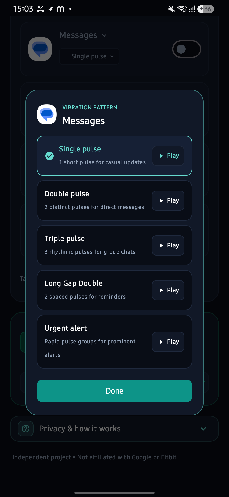
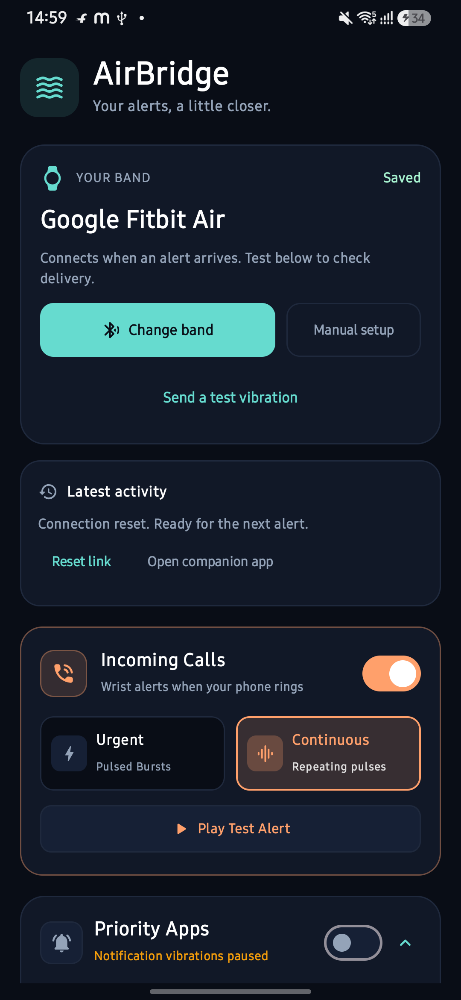
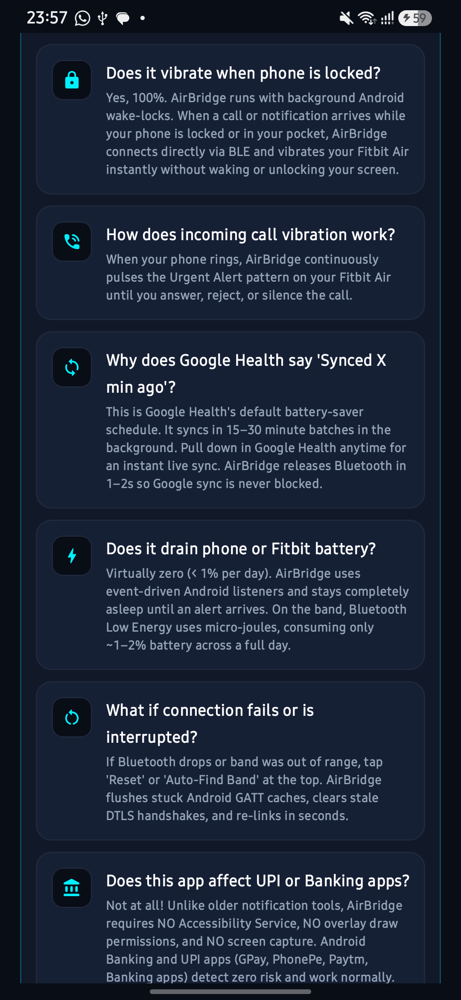
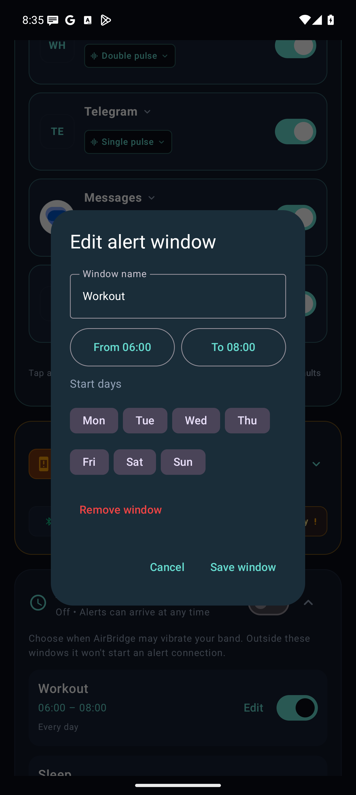

# AirBridge

**Distinct wrist alerts for incoming calls and selected Android app notifications.**

AirBridge is an independent Android project that connects to a Fitbit band over Bluetooth Low Energy (BLE) and triggers vibration patterns for calls and selected notifications. It is designed to help you recognise different alerts without checking your phone.

The current implementation is built around the device identified in the app as **Fitbit Air**. Compatibility with other Fitbit models has not been established. AirBridge is not affiliated with or endorsed by Google or Fitbit.

## Screenshots

<table>
  <tr>
    <td align="center"><br>Dashboard and alert controls</td>
    <td align="center"><br>Vibration pattern selection</td>
  </tr>
  <tr>
    <td align="center"><br>Connection recovery</td>
    <td align="center"><br>In-app information</td>
  </tr>
  <tr>
    <td align="center"><br>Optional alert schedules</td>
    <td align="center"><br>Time and weekday editor</td>
  </tr>
  <tr>
    <td align="center" colspan="2"><br>App-call controls (1.2.1 icon-layout capture; current preview uses Priority Apps-style rows)</td>
  </tr>
</table>

Screenshots show the updated Android interface, including emulator captures of the schedule controls. The schedule starts collapsed, immediately above the FAQ. The Saved badge identifies the chosen band; successful alert delivery is reported separately under Latest activity.

## Features

- **App-call alerts (opt-in):** Up to five installed calling apps with real app icons. WhatsApp, Instagram and Telegram appear first when installed; tap an icon to replace a slot. Discovery uses known apps, declared calling support and incoming-call notifications observed locally. Sends one bounded burst for a recognizable incoming-call notification; compatibility depends on the app and call type.
- **Incoming SIM call alerts:** Choose Urgent or Continuous alert modes.
- **Optional alert schedules:** Editable Workout and Sleep presets, selected weekdays and overnight windows. Scheduling starts off and expands above the FAQ.
- **Priority app rules:** Configure up to five app rules with individual vibration patterns.
- **Pattern previews:** Try patterns on the band from the selection dialog, or send a single test vibration directly from the band card.
- **Connection tools:** Use band detection and reset controls when troubleshooting a connection.
- **On-demand BLE sessions:** Every bounded pattern releases its connection, including repeating call bursts. Opening the companion app from AirBridge pauses alerts for up to five minutes; you can resume sooner.
- **No Accessibility Service:** The manifest does not request an Accessibility Service, overlay access or screen capture.

Available patterns include Single, Double, Triple, Long Gap and Urgent. Continuous call mode repeats alert bursts within the service's configured limits.

## How it works

```text
Incoming call or selected notification
                  |
                  v
Android receiver / notification listener
                  |
                  v
Schedule and sync-pause check
                  |
                  v
Foreground BLE service
                  |
                  v
Golden Gate / Gattlink / DTLS connection
                  |
                  v
CoAP /settings requests to change haptic intensity
                  |
                  v
Restore original intensity and clean up the connection
```

The current implementation generates patterns by changing the band's haptic intensity setting and attempting to restore its original value. It does not use a dedicated `/app/haptics/pulse` endpoint. A recovery checkpoint is saved before the first change and cleared only after the original value is read back. If restoration is uncertain, automatic alerts pause until a manual recovery succeeds. Interrupted connections can still affect delivery.

## Requirements and compatibility

- Android 8.0 or later, as declared by the project's minimum SDK.
- An ARM64 Android device; the current build configuration includes `arm64-v8a` native libraries.
- Bluetooth enabled and a compatible band nearby.
- Notification access for app alerts and phone-state permission for incoming call detection.

The project currently compiles and targets Android API 34. This alone does not establish Android 15 support or 16 KB native page-size compatibility. A verified device and firmware compatibility list is not yet documented.

## Build and setup

Use JDK 17 and an Android SDK installation with API 34. The repository includes local AAR dependencies in `app/libs`.

```bash
git clone https://github.com/ashu-sa/AirBridge.git
cd AirBridge
./gradlew assembleDebug
```

The debug APK is generated at `app/build/outputs/apk/debug/app-debug.apk`.

To install it on a connected device with ADB:

```bash
adb install -r app/build/outputs/apk/debug/app-debug.apk
```

Open AirBridge, grant the permissions for the features you want to use, detect or select the band, and test a vibration pattern before enabling call and notification alerts. Permission prompts vary by Android version; older versions may require location permission for BLE scanning. Background delivery can also depend on your phone's battery settings.

Check [GitHub Releases](https://github.com/ashu-sa/AirBridge/releases) for published builds. If no APK is available, build from source using the steps above.

## Permissions and privacy

AirBridge uses notification access to process notifications for configured apps and phone-state access to detect ringing. Notification access is sensitive: Android grants the listener broader visibility than the app rules used to filter alerts.

The manifest also declares Bluetooth, foreground-service, wake-lock, notification, network and battery-optimisation permissions. Location permission is limited to Android 11 and earlier for BLE scanning. App discovery is scoped to launcher apps and named companion or default apps rather than requesting visibility of every installed package. The BLE stack uses network-style communication internally.

The alert path is designed around local phone-to-band communication. A permission list or source review alone is not proof of zero outbound traffic or a security audit. No universal guarantee is made about banking-app compatibility.

## Development validation

Preview 1.2.1 has 75 passing unit tests and a successful debug build and Android lint run (zero errors; warnings remain). On preview 1.1.0, a Samsung SM-M346B running Android 16 completed controlled tests covering all five alert patterns, original-setting restoration, release between repeating call bursts, schedule closure, recovery, and a real Android notification from a separate test sender. A simulated phone-state event also completed Continuous ring and stopped on answer. This does not establish real carrier-call delivery. Preview 1.1.1 adds event-driven phone-state callbacks and a last-detected-call timestamp after a reported real-call failure; an emulator-generated incoming call reached the callback, but the update still needs a physical-phone retest. See the [1.1.0 validation notes](docs/validation-1.1.0.md) and [call-detection follow-up](docs/validation-1.1.1.md) for the method and limits.

App-call routing has six passing emulator integration checks using a separate notification sender, including duplicate suppression, ongoing-call exclusion, scheduling, settings and cancellation before BLE starts. Live WhatsApp, Slack, Meet and Zoom calls have not been verified. See [app-call validation](docs/validation-1.2.0.md) and [installed-app discovery validation](docs/validation-1.2.1.md).

This is limited development testing, not a compatibility certification. Secure-session retries were observed and an earlier cleanup hang was addressed. Real incoming-call delivery, battery drain and uninterrupted companion-app sync remain unverified. Public releases require a private release signing key; the project no longer signs release builds with the debug key.

## Current limitations

- Secure-session setup can delay the first alert; a short call may end before the band can be reached. Battery drain has not yet been measured unplugged.
- SIM calls use Android phone-state events. App calls use their separate opt-in setting and recognizable incoming-call notifications. Some app versions, Slack huddles, meeting invitations and call types may not expose usable metadata; meeting reminders are not treated as calls.
- Scheduling gates new alert sessions; Android may keep the notification listener process available. No permanent BLE connection, schedule polling loop or exact alarm is added.
- Connection cleanup is intended to support coexistence with the companion app; uninterrupted sync is not guaranteed.
- Background restrictions, firmware changes and Bluetooth interruptions may affect alerts.
- Source availability does not establish compatibility across Fitbit models.

## Feedback

Bug reports and compatibility reports are welcome through [GitHub Issues](https://github.com/ashu-sa/AirBridge/issues). Include your phone model, Android version, band model and firmware, reproduction steps, and expected versus actual behaviour. Remove personal notification content and device identifiers from logs before sharing them.

## License

The existing README declares Apache License 2.0, copyright 2026 Ashutosh Sahoo. See the [Apache 2.0 license terms](https://www.apache.org/licenses/LICENSE-2.0). Bundled third-party libraries remain subject to their respective licenses.
