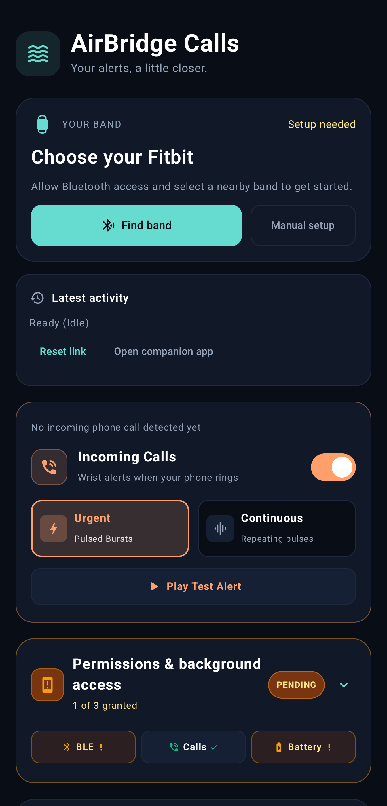
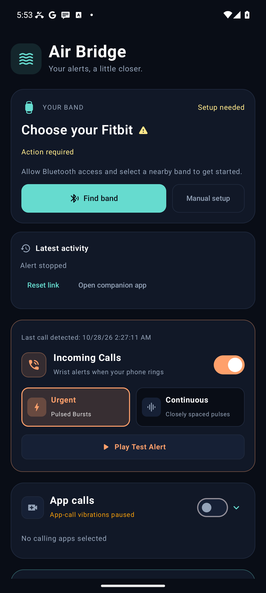
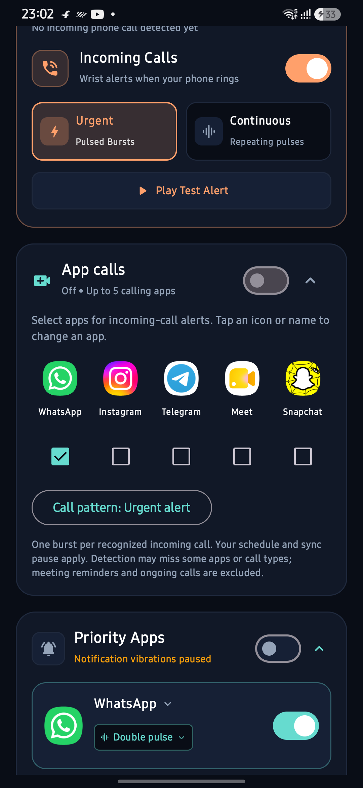
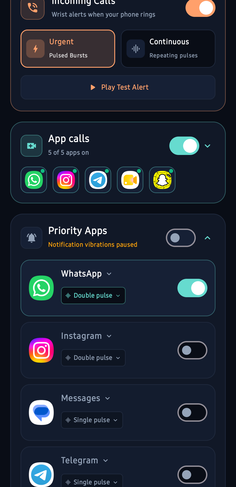
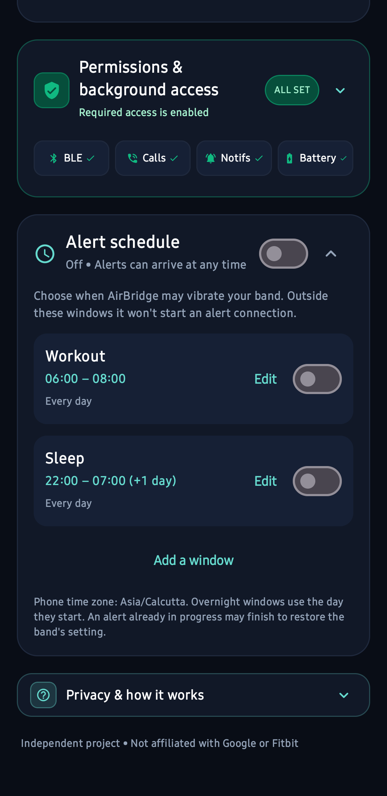

# AirBridge

**Wrist alerts for calls and the apps you choose.**

AirBridge is an independent Android app for Google Fitbit Air. It sends distinct vibration patterns over Bluetooth so you can recognise an alert without checking your phone.

## Choose your edition

| Edition | Download v1.3.4 | Regular SIM calls | App calls & notifications | Notification access |
| --- | --- | --- | --- | --- |
| 📞 Calls only | [⬇ Download APK · 3.91 MB](https://github.com/ashu-sa/AirBridge/releases/download/v1.3.4/AirBridge-Calls-1.3.4.apk) | Yes | No | Not declared |
| 📞 + 🔔 Calls & notifications | [⬇ Download APK · 3.94 MB](https://github.com/ashu-sa/AirBridge/releases/download/v1.3.4/AirBridge-Full-1.3.4.apk) | Yes | Yes | Required for app alerts |

Both include schedules, vibration tests and connection recovery. Calls removes the notification-listener declaration associated with the reported installation block; acceptance by every phone is not guaranteed. Full updates the existing signed release. Calls installs separately; enable alerts in only one edition at a time for the same band.

[Installation options](docs/install.md) · [Report an issue](https://github.com/ashu-sa/AirBridge/issues)

<details>
<summary>Full APK blocked? Optional installation steps</summary>

If the installer offers **Install without scanning** or **Install anyway**, you can choose that option for the official APK. These options are not available on every phone. If you choose to temporarily pause Play Protect: **Play Store → profile → Play Protect → Settings → Scan apps with Play Protect off**, install the official Full APK, then **immediately turn scanning back on and run a scan**. Turning protection off reduces security; installation and safety are not guaranteed. Menu options vary. [Detailed instructions](docs/install.md).

Prefer **Calls** if you only need SIM calls and do not want notification access.

</details>

## Features

- **Phone calls:** Urgent three-pulse bursts or closely spaced Continuous pulses while ringing, for up to 60 seconds. One connection per ringing session; the first Bluetooth handshake is not instant.
- **App calls (Full):** Choose up to five installed calling apps, including WhatsApp, Instagram and Telegram. Tap an app to replace it. Saved choices open immediately while discovery refreshes in the background.
- **Priority apps (Full):** Up to five notification rules with individual vibration patterns.
- **Schedules:** Editable Workout and Sleep presets, weekdays and overnight windows. Off by default.
- **Bluetooth discovery:** Lists nearby BLE, discoverable classic Bluetooth and paired devices. Automatically selects the saved band, or a single Fitbit Air during first setup, and checks the link without vibrating.
- **Band status:** A small icon shows an active connection, required action or a failed attempt. Idle bands reconnect for alerts.
- **Connection controls:** Test vibrations, pause alerts for sync and recover interrupted connections.

## Screenshots

<table>
<tr>
<td><br>Calls edition</td>
<td><br>Full edition</td>
</tr><tr>
<td></td>
<td></td>
</tr><tr>
<td></td>
</tr>
</table>

## Get started

1. Install the APK on an ARM64 phone running Android 8 or newer. If you have a debug preview installed, uninstall it first; its settings will be reset.
2. Allow Bluetooth and phone-state access. Full also needs notification access for app alerts.
3. Select your Fitbit Air and send a test vibration.
4. Choose your call alerts, apps and optional schedule.

**Experimental:** Live call delivery, battery drain and uninterrupted Fitbit sync are still being verified. App-call detection depends on the calling app’s notifications. Other Fitbit models are unverified. See [testing notes](docs/validation-1.3.4.md).

## Privacy

Calls does not include a notification listener. Full processes notification events locally without extracting message text. AirBridge's Bluetooth alerts work offline. No AirBridge cloud account, backend or analytics is used. Notification data is not uploaded; the listener does not extract message text, caller names or OTP codes. The APK still declares Internet permission for its bundled connection stack; offline processing is not a technical prohibition on network access. Settings stay on your phone. Notification access is sensitive, so enable only the features you need. AirBridge is not affiliated with Google or Fitbit.

**Installation options:** Install the APK normally, or use the optional [USB/ADB guide](docs/install.md) if your phone blocks browser downloads. The full app keeps notification and app-call alerts. Phone security policies may still block installation; no universal workaround is promised.

## Build

Use JDK 17 and Android SDK 34:

```bash
git clone https://github.com/ashu-sa/AirBridge.git
cd AirBridge
./gradlew assembleCallsRelease assembleFullRelease
```

GitHub downloads contain **signed, non-debug release APKs only**. To sign a local release, follow the [signing guide](docs/release-signing.md).

## License

Apache 2.0, copyright 2026 Ashutosh Sahoo. Bundled libraries retain their own licenses.
